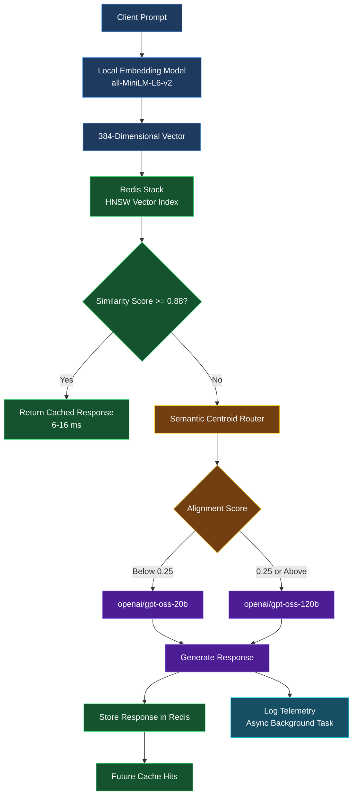

# Semantic Caching & Cost-Aware Routing Gateway

A high-performance LLM gateway engineered to reduce cloud inference costs and API roundtrip latency using local dense embeddings, Redis HNSW vector search, heuristic complexity routing, and real-time observability telemetry.


---

## Key Features

- **Semantic Caching (<16ms)**: Employs local `all-MiniLM-L6-v2` (384-d normalized vectors) and Redis Stack HNSW vector indexing (`COSINE` distance) to serve semantically equivalent queries instantly.
- **Centroid-Based Complexity Routing**: Measures prompt cosine affinity against reasoning centroids to dynamically route requests across tiers:
  - **Lightweight Tier (`openai/gpt-oss-20b`)**: Factual lookups, definitions, and single-turn tasks.
  - **Heavy Reasoning Tier (`openai/gpt-oss-120b`)**: Multi-hop reasoning, comparative distributed systems, and architectural trade-offs.
- **Decoupled Asynchronous Telemetry**: Uses FastAPI `BackgroundTasks` to record request latencies, token consumption, and simulated dollar savings off the client-facing HTTP critical path.
- **Programmatic Cache Control**: `/v1/cache/invalidate` endpoint supporting exact match, semantic threshold eviction, and full cache purges.

---

## Benchmark Results

| Metric | Direct LLM Call | Semantic Cache Hit | Improvement |
| :--- | :--- | :--- | :--- |
| **Response Latency** | 500 ms – 2500 ms | 6 ms – 16 ms | **~97–99% Faster** |
| **Token Cost** | Standard API Rate | $0.00 | **100% Free** |
| **Similarity Threshold** | N/A | $\ge 0.88$ (Cosine) | High Precision |

---


## Architecture Overview



---


## Quickstart

### Prerequisites

- Python 3.10+
- Redis Stack running on `localhost:6379`
- Groq Cloud API Key

### 1. Clone & Set Up Environment

```bash
git clone https://github.com/abhay28-03/semantic-routing-gateway.git

cd semantic-routing-gateway

python -m venv .venv
```

**Windows PowerShell:**

```powershell
.\.venv\Scripts\Activate.ps1
```

**Linux/macOS:**

```bash
source .venv/bin/activate
```

Install dependencies:

```bash
pip install -r requirements.txt
```

### 2. Configure Environment Variables

Create a `.env` file in the project root:

```env
REDIS_HOST=localhost
REDIS_PORT=6379
GROQ_API_KEY=your_groq_api_key_here
```

### 3. Launch Gateway

Run the following command in PowerShell:

```powershell
uvicorn gateway:app --reload --port 8080
```

Once the gateway starts, access:

- **Dashboard:** http://localhost:8080/dashboard
- **Swagger API Docs:** http://localhost:8080/docs

### 4. Run Workload Benchmark

Open a separate PowerShell terminal, activate your virtual environment, and run:

```powershell
python benchmark.py
```

---

## Step 3: Freeze Dependencies & Push to GitHub

Run the following commands from your project root directory in PowerShell.

### 1. Freeze Dependencies

Update `requirements.txt` with the installed packages:

```powershell
.\.venv\Scripts\python.exe -m pip freeze > requirements.txt
```

### 2. Stage Project Files

```powershell
git add .
```

### 3. Verify Git Status

Check that `.env` is not included in the staged files:

```powershell
git status
```

**Important:** Ensure `.env` is listed in `.gitignore` before pushing your repository.

### 4. Commit and Push

```powershell
git commit -m "feat: complete production semantic gateway with centroid routing, async telemetry, and cache invalidation"

git branch -M main

git push -u origin main
```

---

## Deployment Complete

Your Semantic Caching Cost-Aware Routing Gateway is now ready to be version-controlled on GitHub.
