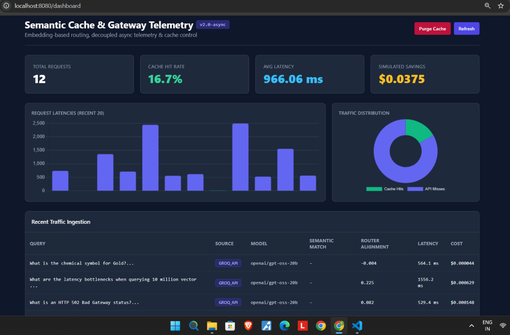

# Semantic Caching & Cost-Aware Routing Gateway

A high-performance LLM gateway engineered to reduce cloud inference costs and API roundtrip latency using local dense embeddings, Redis HNSW vector search, heuristic complexity routing, and real-time observability telemetry.



---

## Key Features

- **Semantic Caching (<16ms)**: Employs local `all-MiniLM-L6-v2` (384-d normalized vectors) and Redis Stack HNSW vector indexing (`COSINE` distance) to serve semantically equivalent queries instantly.
- **Centroid-Based Complexity Routing**: Measures prompt cosine affinity against reasoning centroids to dynamically route requests across tiers:
  - **Lightweight Tier (`openai/gpt-oss-20b`)**: Factual lookups, definitions, and single-turn tasks.
  - **Heavy Reasoning Tier (`openai/gpt-oss-120b`)**: Multi-hop reasoning, comparative distributed systems, and architectural trade-offs.
- **Decoupled Asynchronous Telemetry**: Uses FastAPI `BackgroundTasks` to record request latencies, token consumption, and simulated dollar savings off the client-facing HTTP critical path.
- **Programmatic Cache Control**: `/v1/cache/invalidate` endpoint supporting exact match, semantic threshold eviction, and full cache purges.

---

## Benchmark Results

| Metric | Direct LLM Call | Semantic Cache Hit | Improvement |
| :--- | :--- | :--- | :--- |
| **Response Latency** | 500 ms – 2500 ms | 6 ms – 16 ms | **~97–99% Faster** |
| **Token Cost** | Standard API Rate | $0.00 | **100% Free** |
| **Similarity Threshold** | N/A | $\ge 0.88$ (Cosine) | High Precision |

---

## Architecture Overview
Client Prompt
│
▼
Local Embeddings (all-MiniLM-L6-v2) ──► 384-d Vector
│
▼
Redis Stack HNSW Index (idx:semantic_cache)
│
┌────┴───────────────────────────┐
│ Similarity >= 0.88?             │
├─── YES ──► Serve Cached Response (<16ms)
└─── NO  ──► Semantic Centroid Router
├─ Alignment < 0.25  ──► openai/gpt-oss-20b
└─ Alignment >= 0.25 ──► openai/gpt-oss-120b
│
▼
Store in Redis & Log Telemetry (Async Background)

---

## Quickstart

### Prerequisites
- Python 3.10+
- Redis Stack on `localhost:6379`
- Groq Cloud API Key

### 1. Clone & Set Up Environment
```bash
git clone [https://github.com/abhay28-03/semantic-routing-gateway.git](https://github.com/abhay28-03/semantic-routing-gateway.git)
cd semantic-routing-gateway

python -m venv .venv
# Windows PowerShell:
.\.venv\Scripts\Activate.ps1
# Linux/macOS:
source .venv/bin/activate

pip install -r requirements.txt

2. Configure Environment Variables
Create a .env file in the project root:

Code snippet
REDIS_HOST=localhost
REDIS_PORT=6379
GROQ_API_KEY=your_groq_api_key_here

3. Launch Gateway
PowerShell
uvicorn gateway:app --reload --port 8080
Dashboard: http://localhost:8080/dashboard

Swagger Docs: http://localhost:8080/docs

4. Run Workload Benchmark
PowerShell
python benchmark.py

---

### Step 3: Freeze Dependencies & Push to GitHub

Run these commands in PowerShell:

```powershell
# 1. Update requirements.txt
.\.venv\Scripts\python.exe -m pip freeze > requirements.txt

# 2. Stage all files (ensure .env is in .gitignore)
git add .

# 3. Check status to confirm .env is ignored
git status

# 4. Commit and push
git commit -m "feat: complete production semantic gateway with centroid routing, async telemetry, and cache invalidation"
git branch -M main
git push -u origin main